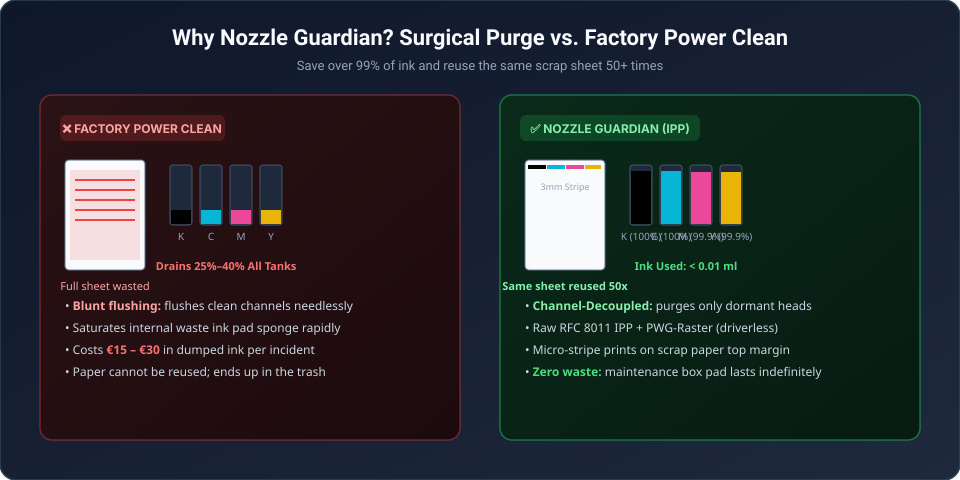

# Nozzle Guardian

[](https://github.com/umbette/nozzle-guardian/actions/workflows/ci.yml)
[](LICENSE)
[](homeassistant/)
[](Dockerfile)

*Proactive, driverless anti-clogging and targeted channel-decoupled purge daemon for EcoTank, MegaTank, Smart Tank & Inkjet printers.*

Eliminates dried ink printhead nozzle clogs on tank and inkjet printers by monitoring Monochrome (K) and Color (CMY) dormancy independently. When a channel remains idle for too long, it triggers targeted micro-stripes via driverless IPP (`image/pwg-raster`) with optional Home Assistant mobile approvals.

<p align="center">
  
</p>

---

## ⚖️ Why Nozzle Guardian? Surgical Purge vs. Factory Power Clean

Factory "Power Cleaning" cycles drain nearly a third of all ink tanks straight into the waste pad just to clear one dried nozzle. Nozzle Guardian replaces this with surgical, channel-decoupled micro-stripes:

| Comparison Metric | Standard Head Clean | Factory "Power Clean" | Nozzle Guardian Surgical Purge |
|---|:---:|:---:|:---:|
| **Ink Consumed** | ~2 – 4 ml | **~8 – 15 ml** | **~0.006 ml** (Picoliter droplets) |
| **Ink Efficiency** | Dumps ink to waste pad | Dumps up to 25% of bottle | **~1,000× less ink used** |
| **Waste Pad / Box Wear** | High | Severe (risks bricking printer) | **Zero** (no ink pumped to waste pad) |
| **Purge Mechanism** | Peristaltic vacuum suction | Aggressive high-pressure suction | Micro-Piezo printhead firing |
| **Paper Required** | Blank sheet | Blank sheet | **Reuses same scrap page 50+ times** |

<p align="center">
  
</p>

---

## 📸 Real-World Live Test Printout

Here is an actual printout generated on an **Epson EcoTank ET-2810** running Nozzle Guardian:

<p align="center">
  
</p>

*Notice how all 4 channels sweep the **full 210 mm page width**, yet consume only a narrow band at the top margin — leaving >85% of the A4 page completely clean for reuse.*

---

## Architecture Principles: 100% Local-First & Zero-Trust

* **Zero Cloud Dependencies:** Completely standalone. No dynamic remote feeds, no telemetry callbacks, and zero external tracking.
* **Universal Driverless IPP:** Sends `image/pwg-raster` directly over IPPS (port 631) without needing CUPS or proprietary PPD drivers. Compatible with Epson EcoTank, Canon MegaTank, HP Smart Tank, and Brother Inkvestment.
* **Full-Width Page-Spanning Bands (210 mm wide × 3 mm tall):** The micro-stripe is **NOT** a 3 mm short tick. It spans the entire width of the page so that **100% of the printhead nozzles across the carriage sweep fire repeatedly**, ensuring all nozzles stay hydrated while preserving paper.
* **Decoupled Channel Tracking (B/W vs Color):** Monitors Black & White and Color page counts separately via printer Web Config and IPP job telemetry.
  * *Print text documents daily?* The Black channel is active, so **zero Black ink is purged**.
  * *Colors dormant for 5 days?* It triggers a targeted flush **only for Cyan, Magenta, and Yellow (CMY)**.
  * *Need both?* CMYK purge only runs when all channels are dormant.
* **Diagnostic Nozzle Inspection Ladder:** Underneath the purge bands, Nozzle Guardian prints micro-comb staircase ladders for each active channel, giving instant visual confirmation that every nozzle is streak-free.
* **Adaptive Auto-Learning Threshold (Home Assistant):** When a purge finishes, Home Assistant sends an actionable push notification (`All Good` vs `Clogged / Clean Needed`). If dry room conditions cause clogs, confirming with one tap automatically shortens the dormancy interval (e.g. from 5 to 4 or 3 days), adapting to your local climate.
* **Waste & Paper Efficiency:** Micro-stripes use $< 0.01\text{ ml}$ ink. You can reuse the exact same scrap paper sheet in the rear feeder dozens of times.
* **Home Assistant Package:** Out-of-the-box actionable notifications with one-tap execution buttons (`[Purge Colors]`, `[Purge Black]`, `[Full Purge]`, `[Snooze 24h]`).

---

## Hardware Compatibility

See [COMPATIBILITY.md](COMPATIBILITY.md) for tested models.
* ✅ **Epson EcoTank ET-2810, ET-2814, ET-2820, ET-2850, ET-4800, L3150 series**
* ✅ **Canon MegaTank, HP Smart Tank & Brother Inkjet series** (IPP Everywhere / PWG-Raster standard)

---

## Quick Start (Docker Compose)

### 1. Configuration
```bash
cp .env.example .env
cp config.example.yaml config.yaml
```
Set your printer's local IP or hostname in `.env`:
```ini
PRINTER_HOST=192.168.1.100
PRINTER_PORT=631
PRINTER_USE_TLS=true
INACTIVITY_DAYS=5
AUTO_PURGE_ENABLED=false
# Leave blank to auto-generate a 32-byte secret in ./data/api_key.secret
API_KEY=
```

> [!NOTE]
> **Fail-Closed API Authentication:** If `API_KEY` is not provided in `.env` and `ALLOW_UNAUTHENTICATED=false`, Nozzle Guardian automatically provisions a persistent 32-byte cryptographic hex secret at `./data/api_key.secret` (file permissions `0600`). Pass this token in the `X-API-Key` HTTP header.

### 2. Launch Daemon
```bash
docker compose up -d
```
The REST API is now running at `http://localhost:8086`.

### 3. Home Assistant Setup
1. Copy `homeassistant/epson_guardian_package.example.yaml` to your `/config/packages/nozzle_guardian_package.yaml`.
2. Replace `YOUR_SERVER_IP` with your host IP and `mobile_app_YOUR_PHONE_NAME` with your device notify service.
3. Reload Home Assistant Packages.

---

## Contributing

We welcome community feedback, pull requests, and verified hardware reports!
- Check [CONTRIBUTING.md](CONTRIBUTING.md) for details on submitting standard PRs and tested models.

---

## License

Distributed under the [MIT License](LICENSE).
