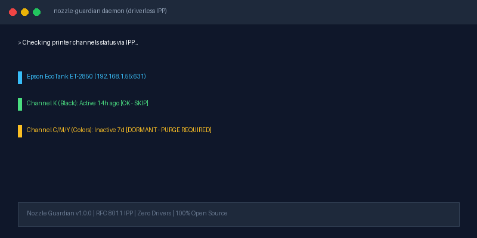
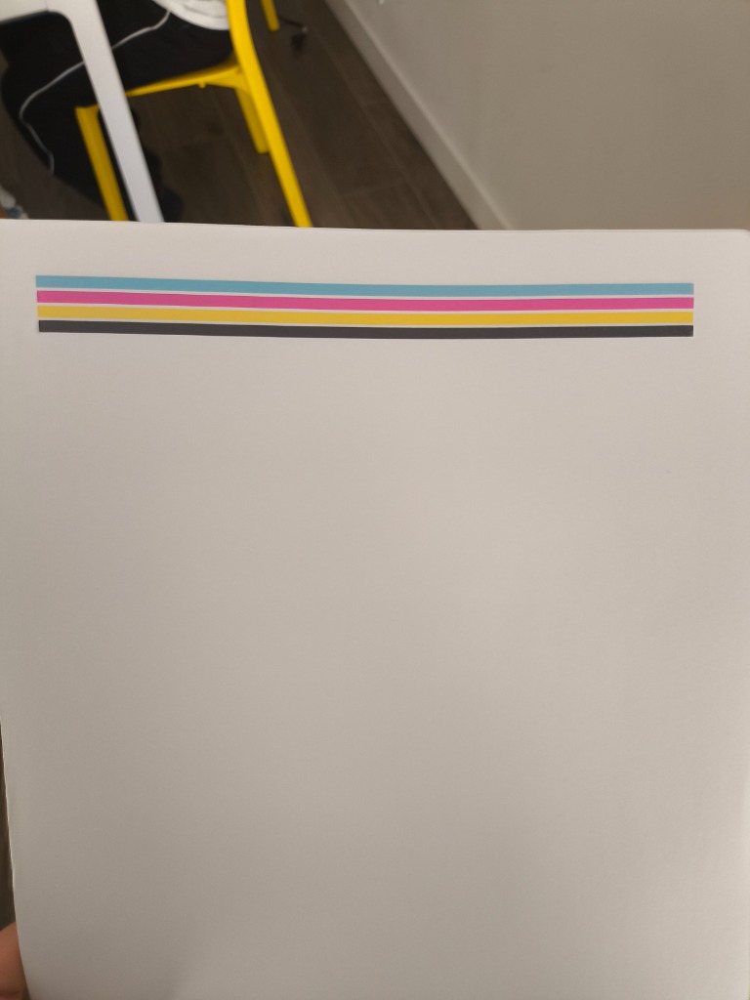

# Nozzle Guardian™

[](https://github.com/umbette/nozzle-guardian/actions/workflows/ci.yml)
[](LICENSE)
[](LICENSE-COMMERCIAL-HARDWARE)
[](ha-addon/)
[](Dockerfile)

*Proactive, 100% pure-Python driverless anti-clogging and targeted channel-decoupled purge daemon for Epson EcoTank, Canon MegaTank/PIXMA, HP Smart Tank/OfficeJet, Brother Inkvestment, and IPP Everywhere Inkjet printers (zero CUPS required).*

Eliminates dried ink printhead nozzle clogs on tank and inkjet printers by monitoring Monochrome (K), Color (CMY), and total-page counters independently via IPP/IPPS (RFC 8011), Vendor EWS, and SNMPv1 Printer-MIB (RFC 3805). When a channel remains idle for too long, it compiles pure-Python PWG-Raster (`image/pwg-raster`), PDF, PNG, or JPEG micro-stripes and dispatches them over IPP with optional Home Assistant mobile approvals.

<p align="center">
  
</p>

---

## ⚖️ Why Nozzle Guardian? Surgical Purge vs. Factory Power Clean

Factory "Power Cleaning" cycles drain nearly a third of all ink tanks straight into the waste pad just to clear one dried nozzle. Nozzle Guardian replaces this with surgical, channel-decoupled micro-stripes:

| Comparison Metric | Standard Head Clean | Factory "Power Clean" | Nozzle Guardian Surgical Purge |
|---|:---:|:---:|:---:|
| **Ink Consumed** | ~2 – 4 ml | **~8 – 15 ml** | **~0.006 ml** (Picoliter droplets) |
| **Ink Efficiency** | Dumps ink to waste pad | Dumps up to 25% of bottle | **~1,000× less ink used** |
| **Waste Pad / Box Wear** | High | Severe (risks bricking printer) | **Zero** (no ink pumped to waste pad) |
| **Purge Mechanism** | Peristaltic vacuum suction | Aggressive high-pressure suction | Micro-Piezo printhead firing |
| **Paper Required** | Blank sheet | Blank sheet | **Reuses same scrap page 50+ times** |

<p align="center">
  
</p>

---

## 📸 Real-World Live Test Printout

Here is an actual printout generated on an **Epson EcoTank ET-2810** running Nozzle Guardian:

<p align="center">
  
</p>

*Notice how all 4 channels sweep the **full 210 mm page width**, yet consume only a narrow band at the top margin — leaving >85% of the A4 page completely clean for reuse.*

---

## Architecture Principles: 100% Local-First & Zero-Trust

* **Zero Cloud Dependencies:** Completely standalone. No dynamic remote feeds, no telemetry callbacks, and zero external tracking.
* **Zero-CUPS Pure-Python IPP Engine (v1.2):** Implements RFC 8011 binary IPP + PWG-Raster (`PWG 5102.4`) encoding, mDNS (`_ipps._tcp` / `_ipp._tcp`), `ipp-usb`, SNMPv1 Printer-MIB (`prtMarkerLifeCount` + ink supplies), and multi-format negotiation (`image/pwg-raster`, `application/pdf`, `image/png`, `image/jpeg`) with A4 / US Letter support (`PRINTER_MEDIA`). Zero OS binaries (`cups`, `ghostscript`, `ipptool`) required.
* **Hardware Safety Guards:** Automatically detects **Laser/LED** toner printers (aborting ink purges), enforces **`media-empty` tray interlocks**, and applies **Thermal BubbleJet safety duty-cycle limits** on Canon/HP heads while keeping acoustic micro-bursts enabled for Piezo heads (Epson/Brother).
* **Full-Width Page-Spanning Bands (210 mm wide × 3 mm tall):** The micro-stripe spans the entire printable width so that **100% of the printhead nozzles across the carriage sweep fire repeatedly**, ensuring all nozzles stay hydrated while leaving the rest of the sheet clean for reuse.
* **Decoupled Channel Tracking (B/W vs Color) + Total-Page Fallback:** Monitors Black & White and Color page counts separately across Epson EWS, HP XML, Canon/Brother EWS, IPP attributes, and SNMPv1 Printer-MIB (`total_pages` dormancy fallback when split counters are unavailable).
  * *Print text documents daily?* The Black channel is active, so **zero Black ink is purged**.
  * *Colors dormant for 5 days?* It triggers a targeted flush **only for Cyan, Magenta, and Yellow (CMY)**.
  * *Need both?* CMYK purge only runs when all channels are dormant.
* **Diagnostic Nozzle Inspection Ladder:** Underneath the purge bands, Nozzle Guardian prints micro-comb staircase ladders for each active channel, giving instant visual confirmation that every nozzle is streak-free.
* **Adaptive Auto-Learning Threshold (Home Assistant):** When a purge finishes, Home Assistant sends an actionable push notification (`All Good` vs `Clogged / Clean Needed`). If dry room conditions cause clogs, confirming with one tap automatically shortens the dormancy interval (e.g. from 5 to 4 or 3 days), adapting to your local climate.
* **Waste & Paper Efficiency:** Micro-stripes use $< 0.01\text{ ml}$ ink. You can reuse the exact same scrap paper sheet in the rear feeder dozens of times.
* **Home Assistant Package:** Out-of-the-box actionable notifications with one-tap execution buttons (`[Purge Colors]`, `[Purge Black]`, `[Full Purge]`, `[Snooze 24h]`).

---

## Hardware Compatibility

See [COMPATIBILITY.md](COMPATIBILITY.md) for tested models.
* ✅ **Epson EcoTank ET-2810, ET-2814, ET-2820, ET-2850, ET-4800, L3150 series**
* ✅ **Canon MegaTank, HP Smart Tank & Brother Inkjet series** (IPP Everywhere / PWG-Raster standard)

---

## Quick Start (Docker Compose)

### 1. Configuration
```bash
cp .env.example .env
cp config.example.yaml config.yaml
```
Set your printer's local IP or hostname in `.env`:
```ini
PRINTER_HOST=192.168.1.100
PRINTER_PORT=631
PRINTER_USE_TLS=true
PRINTER_MEDIA=auto
INACTIVITY_DAYS=5
AUTO_PURGE_ENABLED=false
# Leave blank to auto-generate a 32-byte secret in ./data/api_key.secret
API_KEY=
```

> [!NOTE]
> **Fail-Closed API Authentication:** If `API_KEY` is not provided in `.env` and `ALLOW_UNAUTHENTICATED=false`, Nozzle Guardian automatically provisions a persistent 32-byte cryptographic hex secret at `./data/api_key.secret` (file permissions `0600`). Pass this token in the `X-API-Key` HTTP header.

### 2. Launch Daemon
```bash
docker compose up -d
```
The REST API and standalone Web Dashboard are now live at `http://localhost:8086`.

### 3. Standalone Web Dashboard & Mobile Scanner
You don't need Home Assistant to use Nozzle Guardian! Open `http://<server-ip>:8086/` in any desktop or smartphone browser:
* **Live Hardware Telemetry**: Real-time printer online status and independent Mono/Color page counters.
* **Camera Scan Diagnosis**: Snap a photo of your printed nozzle check sheet directly with your smartphone. Optical computer vision automatically segments channels and highlights missing nozzle rungs.
* **Interactive Surgical Matrix**: Select any clogged nozzle (1 to 10) across Cyan, Magenta, Yellow, or Black to fire high-frequency acoustic micro-pulses exclusively at that single nozzle.

### 4. Home Assistant Add-on & Domotica (Recommended)
1. **Home Assistant Add-on (1-Click Ingress):** Settings ➔ Add-ons ➔ Add-on Store ➔ Repositories ➔ Add `https://github.com/umbette/nozzle-guardian` and install **Nozzle Guardian** (`host_network: true`, native `SUPERVISOR_TOKEN` alerts).
2. **YAML Package Alternative:** Copy [`homeassistant/nozzle_guardian_package.example.yaml`](homeassistant/nozzle_guardian_package.example.yaml) into `/config/packages/`.

### 5. Desktop PC (Windows / macOS / Linux), Smartphone (iOS / Android) & Old Devices
See **[docs/PLATFORMS_GUIDE.md](docs/PLATFORMS_GUIDE.md)** for full instructions covering:
* **Active Owner Smartphone:** Installable PWA + Camera Scanner, `ntfy` mobile push notifications (no Home Assistant needed), and **Apple Shortcuts (`Comandi`)** / **Tasker** via `POST /check`.
* **Desktop Companion:** `python -m src.cli desktop --open-ui` (with wake/boot catch-up) and `python -m src.cli install-desktop` (Windows Task Scheduler, macOS `launchd`, Linux `systemd --user`).
* **Old Devices (Android Termux without Root, Raspberry Pi, Old Laptops, TV Boxes):** Run `./scripts/setup_old_device.sh`.

---

## 💻 Headless CLI & Systemd Timer (No Docker Required)

For minimalists who prefer native systemd timers or cron over Docker and background daemons:

```bash
# 1. Install dependencies into a virtual environment
python3 -m venv .venv
source .venv/bin/activate
pip install -r requirements.txt

# 2. Inspect printer telemetry and channel dormancy
python -m src.cli check

# 3. Run automated audit via cron (purges only when channels exceed dormancy)
python -m src.cli check --cron

# 4. Manually trigger a purge or surgical resuscitation
python -m src.cli purge cmy
python -m src.cli surgical --channel cyan --step 4 --bursts 5

# 5. Diagnose a scanned test sheet from terminal
python -m src.cli scan path/to/printout.jpg

# 6. Generate ready-to-install systemd service & timer units
python -m src.cli systemd
```

---

## 💡 Architecture Decisions & FAQ

### Q1: Why not just use a simple 5-day cron timer that prints a basic SVG strip?
**The "Mono vs. Color Asymmetry Trap":**
A blind timer that resets whenever you print has a critical blind spot: **routine document printing**. 
Most households and offices print text documents, shipping labels, recipes, or tax forms in black & white every week. A naive timer sees "Printed today → Reset 5-day timer". 
Meanwhile, the **Cyan, Magenta, and Yellow (CMY)** nozzles sit completely idle for 3–6 months and bake solid. 

Nozzle Guardian queries internal hardware telemetry (`/PRESENTATION/HTML/TOP` page counters) to **decouple Monochrome and Color tracking**. If you print 50 text pages, only the Black timer resets; CMY channels will still trigger a targeted color micro-purge when their threshold expires.

### Q2: My printer only has USB and NO Wi-Fi (e.g., Canon PIXMA G2770, Epson L3110) — does it work?
**Yes — in two ways depending on your printer's USB firmware:**
1. **Modern USB IPP printers (`ipp-usb`):** On Linux (`sudo apt install ipp-usb`), exposing `http://127.0.0.1:60000` provides zero-driver IPP over USB (`PRINTER_HOST=127.0.0.1`, `PRINTER_PORT=60000`).
2. **Legacy / Host-Based USB-Only Printers without IPP-over-USB (like Canon PIXMA G2770):** Plug the USB cable into any Windows, macOS, or Linux PC/Raspberry Pi with the vendor driver installed, run **Nozzle Guardian Desktop** (`python -m src.cli desktop --open-ui`), click **🔎 Scopri LAN/USB** and select **`local://<QueueName>`** (or set `PRINTER_HOST=local://<QueueName>`). Nozzle Guardian tracks completed OS spool jobs, applies Thermal BubbleJet safety limits, and prints micro-stripes natively over the USB queue!

### Q3: Won't re-feeding scrap paper dozens of times cause jams?
**Paper Handling & Practical Reuse:**
Repeatedly running the exact same sheet 20+ times through a printer can cause paper jams due to edge curling, humidity, and roller static.
Nozzle Guardian was deliberately designed with a **2.5 mm micro-stripe at the absolute top margin**:
* **Domestic Reuse Pile:** The sheet can immediately go into your daily scratch paper, recipe, or quick-draft tray. Over 98% of the A4 page remains pristine.
* **Flipping Once:** You can flip the sheet once to use the other side.
* You do **not** need to cycle the same piece of paper indefinitely—a single scrap sheet every couple of weeks easily covers all preventive maintenance.

---

## Contributing

We welcome community feedback, pull requests, and verified hardware reports!
- Check [CONTRIBUTING.md](CONTRIBUTING.md) for details on submitting standard PRs and tested models.

---

## Prior Art, Trademarks & Licensing (Hybrid Open-Core)

* **Software Core, Home Assistant Add-on & Desktop Companion:** Distributed under the **[GNU AGPLv3](LICENSE)** (includes network copyleft and hardware Anti-Tivoization §6).
* **Smart Dongle Firmware (`firmware/`), Mechanical CAD (`hardware/enclosure.scad`) & OEM Appliances:** Governed by **[PolyForm Noncommercial License 1.0.0](LICENSE-COMMERCIAL-HARDWARE)** — 100% free for personal, home, and educational use; commercial dongle manufacturing or bundling requires a Commercial OEM License from Umberto (`umbette`).
* **Prior Art & Defensive Disclosure:** **[docs/PRIOR_ART.md](docs/PRIOR_ART.md)** • **[CITATION.cff](CITATION.cff)** • **[TRADEMARKS.md](TRADEMARKS.md)** • **[SECURITY.md](SECURITY.md)**.
