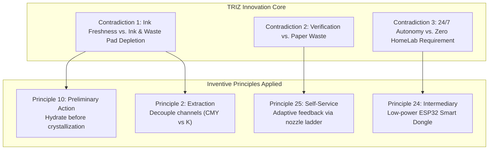
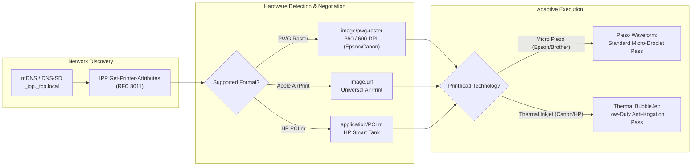
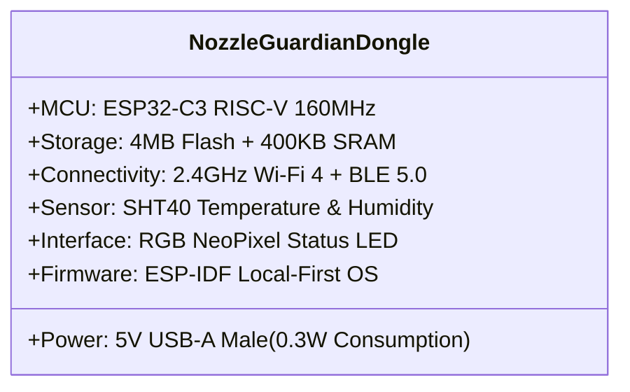
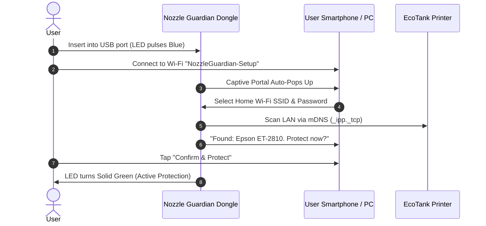
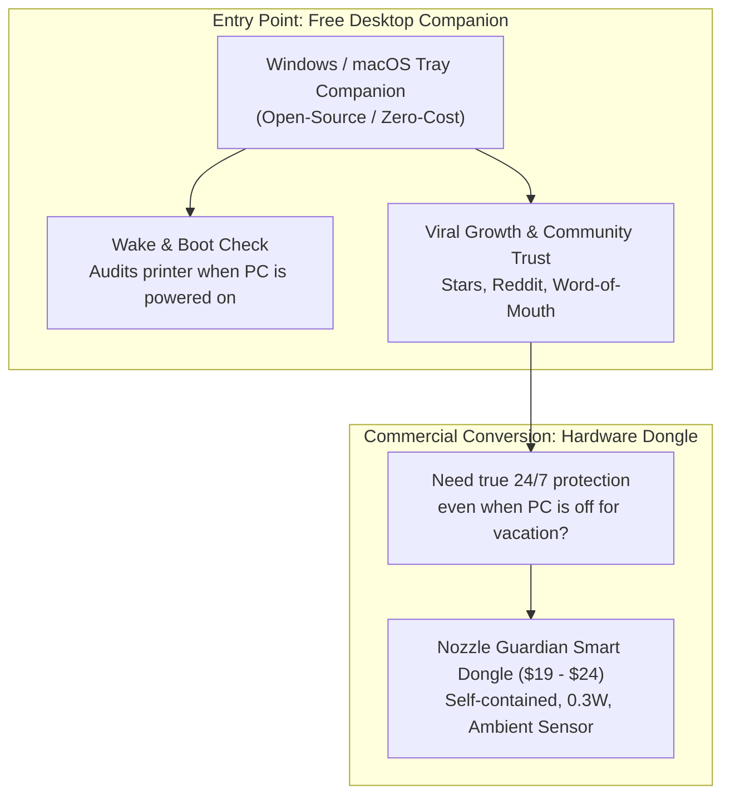
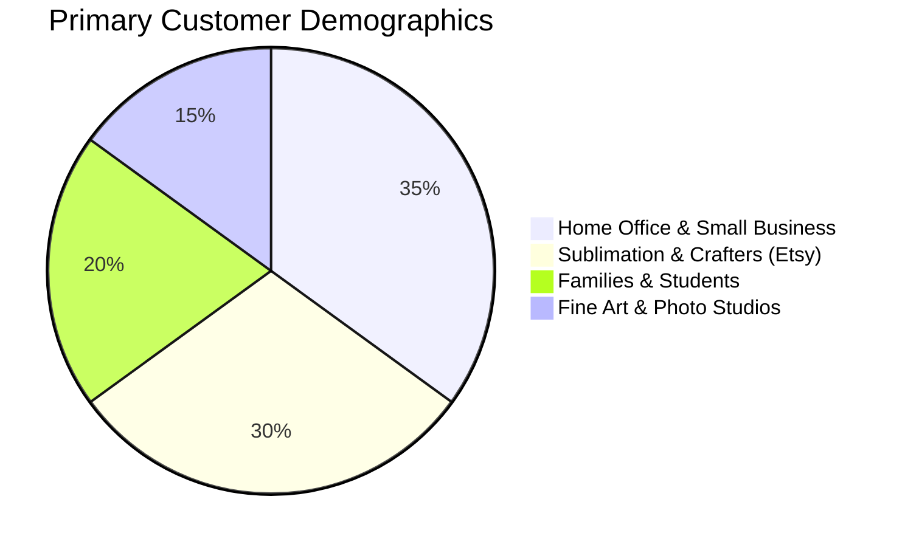

# Nozzle Guardian™ — Master Product Blueprint & EGM Innovation Roadmap
*From Open-Source Utility to Mass-Market Consumer Hardware & Ecosystem*

---

## Executive Summary

**Nozzle Guardian™** is a proactive, driverless, channel-decoupled anti-clogging platform designed for continuous ink supply systems (CISS) and inkjet printers (Epson EcoTank, Canon MegaTank, HP Smart Tank, Brother Inkvestment). 

By replacing destructive, ink-draining manufacturer "Power Cleaning" cycles with microscopic, horizontal page-spanning purges and diagnostic staircase verification, Nozzle Guardian eliminates dried ink clogs while consuming **< 0.006 ml** of ink per cycle (a **~1,000× reduction** in ink waste) and placing **zero wear** on internal waste ink sponges.

This document represents the complete productization roadmap generated using the **Enhanced Goldfish Method (EGM)**, incorporating TRIZ inventive principles, architectural reviews, commercial strategies, and unexplored high-growth opportunities.

---

## 1. EGM Multi-Perspective Analysis & TRIZ Contradiction Matrix

### 1.1 Technical Contradictions Resolved

| System Contradiction | Traditional Approach (Failure) | Nozzle Guardian TRIZ Solution | TRIZ Inventive Principle |
|---|---|---|---|
| **Ink Hydration vs. Waste Pad Life** | Run aggressive 15-min pump suction (drains 10 ml into waste pad, filling EEPROM counter). | Fire piezo crystals at micro-droplet scale across page margin; zero ink to waste pad. | **Principle 10 (Preliminary Action)** + **Principle 2 (Extraction)** |
| **Channel Cleanliness vs. Unneeded Ink Waste** | Clean all channels simultaneously, dumping expensive color ink even if only black was idle. | Polling internal hardware page counters to decouple CMY from K. Purge *only* dormant lines. | **Principle 1 (Segmentation)** |
| **Nozzle Health Verification vs. Paper Consumption** | Spit into dark waste sponge (zero observability) or print full test pages. | 3 mm solid purge band + micro-comb staircase ladders on top 40 mm margin of recyclable scrap sheet. | **Principle 25 (Self-Service)** + **Principle 6 (Universality)** |
| **Always-On Autonomous Daemon vs. Mass Consumer Simplicity** | Require a 24/7 Linux server / Home Assistant instance. | Dual-Track: Free Desktop Wake-Catchup Companion + \$19 Plug-and-Forget USB Dongle. | **Principle 24 (Intermediary)** |

---

## 2. Universal Software Architecture & Printhead Adaptability

### 2.1 Printhead Physics: Micro-Piezo vs. Thermal Inkjet

A universal anti-clog tool must respect the physical divergence between printhead actuation mechanisms:

1. **Micro-Piezo Technology (Epson, Brother):**
   * *Mechanism:* Piezoelectric ceramic elements mechanically deflect behind the ink chamber.
   * *Risk:* Ink drying in nozzles forms a rubbery crust; cold clogs without heat generation.
   * *Purge Profile:* High-frequency, high-velocity drop bursts to mechanically shatter meniscus crystallization.
2. **Thermal BubbleJet Technology (Canon MegaTank, HP Smart Tank):**
   * *Mechanism:* Microscopic electrical thin-film resistors flash-heat ink to $> 300^\circ\text{C}$ to create a vapor bubble that expels a droplet.
   * *Risk:* Dry firing causes **kogation** (burnt ink crust baked directly onto the resistor), permanently destroying the nozzle heater.
   * *Purge Profile:* Gentle, pulsed low-duty cycles to ensure ink chamber refills before the heater fires again, preventing thermal burnout.

### 2.2 Universal Raster & Protocol Engine

* **Protocol:** Pure IPP (Internet Printing Protocol over HTTP/HTTPS, port 631).
* **Format Negotiation Pipeline:**
  1. Discover printer via `_ipp._tcp` and `_ipps._tcp` DNS Service Discovery.
  2. Issue `Get-Printer-Attributes` requesting `document-format-supported`, `printer-resolution-supported`, `color-supported`, and `marker-levels`.
  3. Format selection priority:
     - **PWG-Raster (`image/pwg-raster`):** Strict standard compliance for Epson/Canon/Xerox.
     - **Apple AirPrint URF (`image/urf`):** Universal fallback supported by > 98% of consumer wireless printers.
     - **PCLm / PCLmS (`application/PCLm`):** Optimized stream for HP and Canon devices.
* **On-the-Fly Dynamic Generator:** A zero-dependency procedural raster generator in C/Rust (for microcontroller) and Python (for desktop/daemon) that compiles 360/600 DPI rasters on the fly without heavy image processing dependencies.

---

## 3. Hardware Platform: The Nozzle Guardian™ Smart Dongle

### 3.1 Hardware Architecture & Bill of Materials (BOM)

To keep retail pricing at an impulse-buy level (\$19 – \$24) while maintaining healthy gross margins (> 65%), the dongle uses a minimal, highly integrated architecture:

| Component | Part / Specification | Purpose | Unit Cost (1k pcs) |
|---|---|---|:---:|
| **MCU & Wireless** | ESP32-C3-WROOM-02 (RISC-V 160MHz) | Wi-Fi 4, BLE 5, cryptographic engine, TCP/IP stack | \$1.90 |
| **Environmental Sensor** | Sensirion SHT40 / AHT20 | Ambient temperature & relative humidity measurement | \$0.65 |
| **Status Feedback** | WS2812B RGB Smart LED | Intuitive visual state (Green, Blue, Yellow, Red) | \$0.08 |
| **Power & Interconnect** | Integrated USB-A Male Connector | Direct insertion into printer USB or 5V wall charger | \$0.25 |
| **PCB & Passive Array** | 2-Layer FR4 with onboard trace antenna | LDO regulator, bypass capacitors, ESD protection | \$0.70 |
| **Enclosure** | Injection-molded matte PC-ABS (white/black) | Compact thumb-drive form factor with lanyard loop | \$0.85 |
| **Packaging & Quick Guide** | Recycled Kraft paper retail box + QR code card | Compact, eco-friendly retail presentation | \$0.50 |
| **Total BOM Cost** | | | **\$4.93** |

### 3.2 Environmental Intelligence: The Predictive Drying Engine

Standard maintenance algorithms rely purely on static day counters. The Nozzle Guardian Smart Dongle introduces the **Predictive Drying Engine**:
* Ink evaporation rate follows the **Antoine & Fickian Diffusion Equations**, accelerating drastically in low relative humidity (< 35% RH) and high ambient temperatures.
* **Dynamic Interval Adjustment:**
  * **Normal conditions (45% – 60% RH, 20°C):** Default interval = **5 days**.
  * **Winter heating / Summer AC (< 30% RH):** Interval dynamically tightens to **3 days** to prevent crusting.
  * **Humid climate (> 65% RH):** Interval safely relaxes to **7 – 8 days**, further conserving ink and paper.

---

## 4. UI/UX & Setup Experience ("Grandma-Proof" Onboarding)

### 4.1 Zero-Friction Web Dashboard (`http://nozzle.local`)

* **No App Store Requirement:** Runs as a responsive Progressive Web App (PWA) served directly from the dongle’s flash memory.
* **Dashboard Features:**
  * **Visual Printhead Gauge:** Visual health indicators for Black, Cyan, Magenta, Yellow.
  * **Ambient Climate Telemetry:** Real-time room humidity and temperature graphs showing evaporation risk.
  * **Action Controls:** `[Instant Purge]`, `[Inspect Nozzles]`, `[Pause 14 Days (Vacation Mode)]`.
  * **Paper Reuse Counter:** Displays how many purges have been printed on the current scrap sheet.

---

## 5. Dual-Product Strategy: Desktop App + Hardware Dongle

1. **Free Desktop Companion (Windows & macOS):**
   * Distributed as an open-source, single-executable `.exe` and `.dmg`.
   * Lives in the system tray. Executes silent checks on system boot and wake-from-standby.
   * Acts as the top-of-funnel acquisition engine, converting frustrated printer owners into loyal advocates.
2. **The Smart USB Dongle (\$19 – \$24):**
   * The commercial hardware product for users who travel, turn off their laptops, or want true "plug-and-forget" autonomy.

---

## 6. Commercial Strategy, Monetization & Go-To-Market

### 6.1 Target Audience Segments

1. **The Sublimation & Crafting Community (High-Value Niche):**
   * *Pain Point:* Crafters routinely convert Epson EcoTanks (ET-2720, ET-2800, ET-15000) to **sublimation ink** for t-shirts, mugs, and crafts. Sublimation ink is hyper-viscous and dries up to **3× faster** than regular dye ink. A clog ruins high-value transfer paper and sublimation blanks.
   * *Pricing Sensitivity:* High willingness to pay (\$25 – \$35) because printhead replacement costs \$150+.
2. **Home Office & Teleworkers:**
   * People who bought tank printers during remote work, print text 2 days a week, and find color channels dead when they need to print a color chart or ticket.
3. **DTF (Direct-to-Film) & Textile Printing:**
   * Uses heavy titanium white pigment ink that settles and clogs within 48 hours. Nozzle Guardian custom firmware with 24-hour agitation purges represents an industrial-grade lifesaver.

### 6.2 Sales Channels & Roadmap

* **Phase 1: Crowd-Validation (Kickstarter / Indiegogo):**
  * Target: \$25,000 funding goal (1,200 units).
  * Video hook: Side-by-side comparison of a 15-minute ink-draining Power Clean emptying a tank vs. Nozzle Guardian’s 5-second 3 mm micro-purge.
* **Phase 2: Amazon Storefront (FBA):**
  * Targeted PPC keywords: *"EcoTank printhead cleaning"*, *"Epson nozzle check failed"*, *"clogged printer ink fix"*, *"Sublimation printer maintenance"*.
* **Phase 3: B2B Partnerships:**
  * Affiliate bundling with third-party ink refill brands (Hiipoo, Printers Jack) and sublimation supply shops.

---

## 7. Branding, Logo & Visual Identity

* **Brand Name:** **Nozzle Guardian™**
* **Brand Tagline:** *"Never dry. Never clogged. Always ready."*
* **Visual Iconography:** A clean, geometric shield rendered in deep space gray, enclosing a stylized droplet that transitions into a 4-nozzle precision micro-array emitting CMYK beams (Cyan, Magenta, Yellow, Key-Black).
* **Tone of Voice:** Engineered, friendly, honest, anti-waste. Championing the consumer against planned obsolescence and wasteful printer firmware tricks.

---

## 8. Revolutionary Unexplored Opportunities (Horizon 2 & 3)

### 8.1 Smartphone AI Camera Nozzle Scanner (Zero-Effort Diagnosis)
* *Concept:* In the web UI or mobile notification, a button says: `[Scan Test Sheet]`.
* *Mechanism:* The smartphone camera takes a quick picture of the staircase ladder.
* *Processing:* A lightweight WebAssembly computer vision filter (or Gemini Flash endpoint) automatically:
  1. Detects the ladder steps.
  2. Identifies any breaks or missing lines per channel.
  3. Outputs: *"Black: 100% | Cyan: 98% | Magenta: 100% | Yellow: 85% (3 missing nozzles)"*.
  4. Automatically recommends: *"Keep current threshold"* or *"Reducing dormancy threshold by 1 day"*.

### 8.2 The "Paper Loop Clip" (Zero-Touch Continuous Re-Feeder)
* *Concept:* A low-cost 3D-printed clip attached to the printer’s rear tray that creates an endless loop of paper or a small synthetic reusable wipe band, eliminating the need to ever load a sheet of paper for maintenance purges.

---

## 9. Immediate Implementation Plan

| Action Item | Milestone Target | Deliverables |
|---|---|---|
| **1. Standalone Web UI** | Week 1 | Embed responsive web interface directly into current FastAPI daemon (`src/main.py`) |
| **2. Universal AirPrint / PCLm Engine** | Week 2 | Implement URF & PCLm fallback generator in `src/generator.py` for HP/Canon |
| **3. Desktop Companion (Windows/Mac)** | Week 3 | Build PyInstaller single `.exe` tray app with boot/wake scheduler |
| **4. ESP32-C3 Firmware Prototype** | Week 5 | ESP-IDF firmware with IPP client + Captive Portal setup |
| **5. Sublimation Community Alpha** | Week 7 | Distribute 20 prototype units to craft/sublimation YouTubers for viral review |
